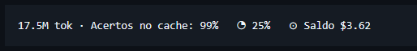
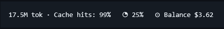

# dsh-account-balance-chip

Um chip de saldo para o [DeepSeek Harness](https://github.com/deepseek-ai/deepseek-harness): mostra o **saldo da conta conectada** no fim da linha de estatísticas do compositor — a mesma linha que já mostra tokens, cache e o medidor de contexto.



Plugin de comunidade, independente: não é oficial, não tem relação com a DeepSeek e não compartilha código com outros plugins de saldo.

## O que ele faz

- Mostra o saldo **reabastecido** da carteira da sua conta, com o mesmo formato da tela **Configurações → Conta** (`$3.62`, `$1,234.50`, `<$0.01`).
- Fica no **fim** da linha de estatísticas, depois da porcentagem de contexto, com a mesma fonte, tamanho e cor dos números vizinhos.
- Passar o mouse mostra o saldo reabastecido e os bônus concedidos.
- **Clicar abre a página de recarga** (*Top up*) da plataforma, a mesma do botão **Recarregar** em Configurações → Conta.
- Atualiza sozinho: ao abrir, no máximo **1 vez por minuto**, e na hora em que a janela volta ao foco (com piso de 15 s entre leituras).

## Estados

| Situação | O que aparece |
|---|---|
| Tudo certo | `Saldo $3.62` |
| Falhou a leitura, mas já havia valor | o último valor, esmaecido; o tooltip diz “Último valor conhecido” |
| Falhou e nunca houve valor | `Saldo —`, esmaecido |
| Sem conta conectada | o chip some |

## Instalação

Requer **DeepSeek Harness 0.2.2-rc.5 ou mais novo** (desktop ou web) e uma conta DeepSeek conectada.

1. Baixe este repositório (**Code → Download ZIP**) e descompacte.
2. Abra o DSH, vá em **Configurações → Plugins** e use **Add plugin** escolhendo a pasta descompactada.
3. Deixe a entrada “Saldo da conta” habilitada. Se o chip não aparecer, recarregue a janela.

Para desinstalar: **Configurações → Plugins** → remova o bundle `dsh-account-balance-chip`.

## Como funciona

O plugin é um *bundle* de cliente: um `package.json` com a seção `dsh`, um patch que insere uma linha e um módulo de cliente. Não tem build, não tem dependências e a metade Host é vazia.

- O chip se registra no slot `conversation.composer.dock` (a linha horizontal de estatísticas do compositor) e usa `order` do flex para ficar depois do medidor de contexto.
- O valor vem de `ctx.remote.account.getBalance(...)`, exatamente a chamada que a tela **Configurações → Conta** faz. Quem fala com a plataforma é o processo Host, com as credenciais da conta: o navegador não vê token, e o plugin não lê nem grava chave de API.
- Nada é salvo em disco. Uma leitura é compartilhada por todos os chips abertos; sem chip na tela, sem requisição.

## Limitações

- É **polling**, não push: uma mudança aparece em até ~1 minuto, ou na hora quando a janela ganha foco.
- Mostra **uma** carteira (USD quando existir; senão a primeira). A tela de Conta lista todas.
- Depende do plugin de conta do DSH estar montado (`remote.account`); sem ele o chip não ativa.
- O saldo só muda depois que o consumo do turno é cobrado, então o número pode levar alguns segundos além do fim da resposta.
- A recarga abre no **navegador padrão**; a janela embutida do desktop (a que aparece em Configurações → Conta) não é exposta para plugins.

## Solução de problemas

- **O chip não aparece** — confira se a linha “Saldo da conta” está habilitada em **Configurações → Plugins** e recarregue a interface. No DSH Desktop do Windows o menu do app não tem “Reload” e `Ctrl+R`/`F5` não funcionam: use **F12**, aba **Console**, e rode `location.reload()` — ou o botão **“Tente esta página novamente”** no aviso de plug-ins.
- **`loaded without registering "dsh-account-balance-chip" via __ModuleLoader__.load`** — o Host ainda está servindo em memória uma cópia antiga do bundle, o que acontece depois de renomear o pacote ou reinstalar a mesma versão. Toque o arquivo `client.js` (basta salvar de novo) para o Host republicar e recarregue a página.
- **`Saldo —` esmaecido** — a leitura da conta falhou (conta desconectada ou Platform indisponível); o chip volta sozinho na próxima leitura bem-sucedida.

## Desenvolvimento

```
client.js          módulo de cliente: slot, leitura do saldo, chip
index.js           metade Host (vazia)
cordis.patch.yml   insere a linha do plugin no perfil
locale/*.json      título e descrição do plugin (pt, en, es)
icon.svg           ícone do plugin
```

Sem build: editar `client.js` e recarregar a janela já mostra o resultado (a metade Host vazia não precisa reiniciar o app).

Tudo no `client.js` vive **dentro de `factory(require)`**: o carregador pode avaliar o script mais de uma vez no mesmo escopo global, e um `const` no topo do arquivo quebra com *“Identifier 'NS' has already been declared”* na segunda execução.

---

# English

A balance chip for [DeepSeek Harness](https://github.com/deepseek-ai/deepseek-harness): shows the **signed-in account balance** at the end of the composer stats row — the line that already reports tokens, cache hits and the context meter.



Unofficial community plugin: not affiliated with DeepSeek, and sharing no code with other balance plugins.

## What it does

- Shows the **topped-up** wallet balance, formatted like **Settings → Account** (`$3.62`, `$1,234.50`, `<$0.01`).
- Sits at the **end** of the stats row, after the context percentage, with the same font, size and colour as its neighbours.
- Hovering lists the topped-up balance and any granted bonus balance.
- **Clicking opens the platform's top-up page** — the same destination as the **Top up** button in Settings → Account.
- Refreshes itself: on mount, at most **once a minute**, and immediately when the window regains focus (15 s floor between reads).

## States

| Situation | What you see |
|---|---|
| Ready | `Balance $3.62` |
| Read failed but a value exists | the last value, dimmed; tooltip says “Last known value” |
| Read failed with no value yet | `Balance —`, dimmed |
| Signed out | nothing |

## Install

Requires **DeepSeek Harness 0.2.2-rc.5 or newer** (desktop or web) and a signed-in DeepSeek account.

1. Download this repository (**Code → Download ZIP**) and unpack it.
2. In DSH open **Settings → Plugins**, then **Add plugin** and pick the unpacked folder.
3. Keep the “Saldo da conta” row enabled. If the chip does not show up, reload the window.

Uninstall: **Settings → Plugins** → remove the `dsh-account-balance-chip` bundle.

## How it works

The plugin is a client bundle: a `package.json` with a `dsh` section, a patch that inserts one row, and a client module. No build step, no dependencies, and an empty Host half.

- The chip registers in the `conversation.composer.dock` slot (the composer's horizontal stats row) and uses flex `order` to land after the context meter.
- The value comes from `ctx.remote.account.getBalance(...)` — the very call the **Settings → Account** page makes. The Host process talks to the platform with the account credentials: the browser never sees a token, and the plugin neither reads nor stores an API key.
- Nothing is written to disk. One read is shared by every mounted chip; no chip on screen means no request.

## Limitations

- It is **polling**, not push: a change shows up within about a minute, or immediately when the window regains focus.
- It shows **one** wallet (USD when present, else the first). The Account page lists them all.
- It needs the DSH account plugin (`remote.account`); without it the chip stays inactive.
- The balance only moves after the turn's usage is billed, so the number can trail the end of a reply by a few seconds.
- Top-up opens in the **default browser**; the desktop's embedded window (the one Settings → Account shows) is not exposed to plugins.

## Troubleshooting

- **The chip is missing** — check that the “Saldo da conta” row is enabled under **Settings → Plugins**, then reload the UI. On DSH Desktop for Windows the app menu has no “Reload” and `Ctrl+R`/`F5` do nothing: press **F12**, open the **Console** and run `location.reload()` — or click **“Try this page again”** in the plugin-sync notice.
- **`loaded without registering "dsh-account-balance-chip" via __ModuleLoader__.load`** — the Host is still serving an old in-memory copy of the bundle, which happens after renaming the package or reinstalling the same version. Touch `client.js` (save it again) so the Host republishes it, then reload the page.
- **Dimmed `Balance —`** — the account read failed (signed out, or the Platform is unreachable); the chip recovers on the next successful read.

## Licence

MIT — see [LICENSE](LICENSE).
